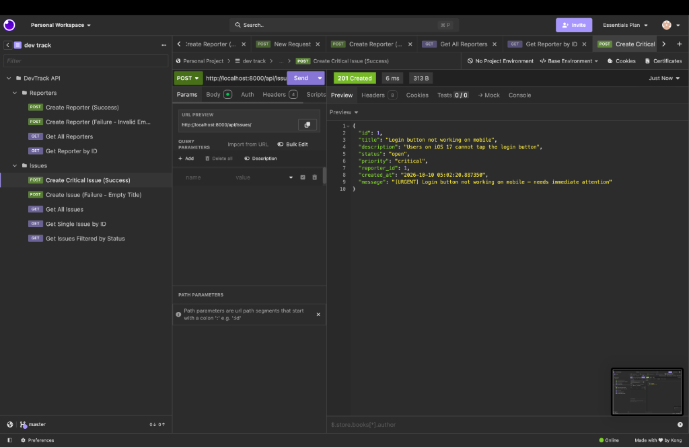
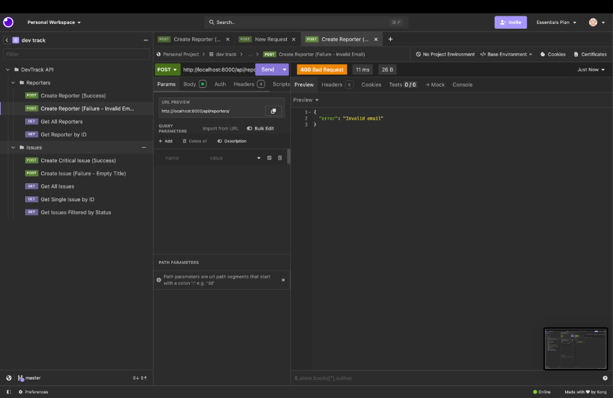
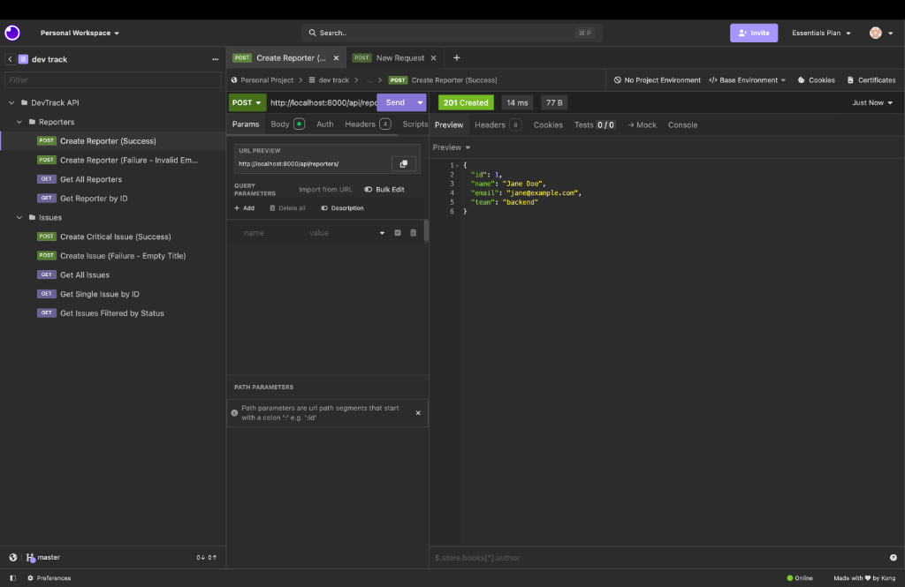
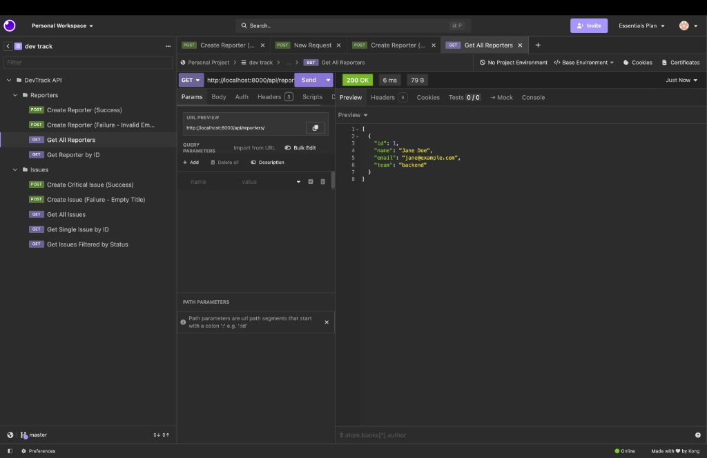
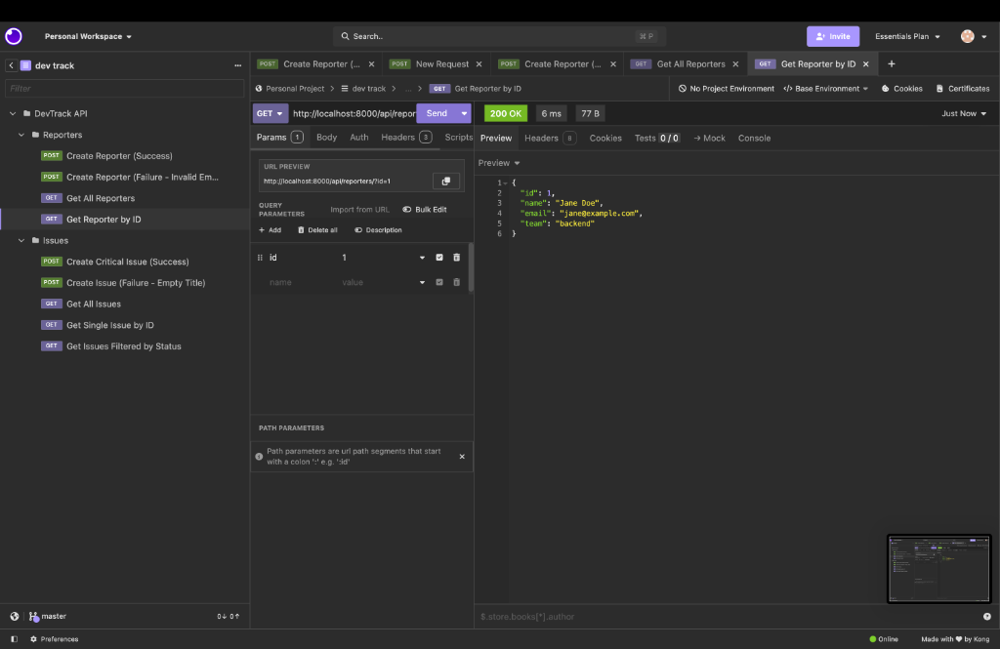

# DevTrack - Backend API for Engineering Issue Tracking

DevTrack is a lightweight Django-based REST API designed for engineering teams to report bugs, set priorities, and track issue statuses (similar to GitHub Issues). 

The backend is built around core **Object-Oriented Programming (OOP)** principles using Python domain models (`BaseEntity`, `Reporter`, `Issue`, `CriticalIssue`, `LowPriorityIssue`) and persists records cleanly in JSON files (`reporters.json` and `issues.json`).

---

## 🛠️ Requirements & Setup Instructions

### Option A: Running with Docker (Recommended)

DevTrack is fully Dockerized. When the container starts, the container `entrypoint.sh` automatically runs database migrations (`python manage.py makemigrations` & `python manage.py migrate`) before starting the server.

```bash
# Build and launch container in background
docker compose up --build -d

# View container logs (including automatic startup migrations)
docker compose logs -f web

# Stop container
docker compose down
```

The API will be available at `http://127.0.0.1:8000/`.

---

### Option B: Running Locally with Python Virtualenv

### Prerequisites
- **Python 3.10+**
- **pip** and **venv**

#### 1. Installation & Environment Setup
Navigate to the project root directory and set up a virtual environment:

```bash
# Clone or open project directory
cd devtrack

# Create a virtual environment
python3 -m venv venv

# Activate virtual environment
# On macOS/Linux:
source venv/bin/activate
# On Windows:
# venv\Scripts\activate

# Install dependencies
pip install -r requirements.txt
```

#### 2. Run Database Migrations & Start Server

```bash
# Run migrations
python manage.py makemigrations
python manage.py migrate

# Start server
python manage.py runserver 0.0.0.0:8000
```

The API will be live at `http://127.0.0.1:8000/`.

---

## 🧪 Running Automated Tests

A comprehensive verification test suite is provided in `test_devtrack.py` to test domain models, validation rules, polymorphism, and HTTP endpoint responses (201, 200, 400, 404):

```bash
python test_devtrack.py
```

---

---

## 📸 Postman / API Client Screenshots

All endpoints were tested in Postman using the included collection [`DevTrack.postman_collection.json`](DevTrack.postman_collection.json). Below are the verified test results:

### 1. Issue Endpoint - Success (`POST /api/issues/` - `201 Created`)
Creating a critical issue dynamically instantiates the `CriticalIssue` model subclass and returns `201 Created` with the urgent message banner:
`[URGENT] Login button not working on mobile — needs immediate attention`



---

### 2. Reporter Endpoint - Failure (`POST /api/reporters/` - `400 Bad Request`)
Submitting an invalid email (missing `@`) triggers the `Reporter.validate()` method and returns `400 Bad Request` with `{"error": "Invalid email"}`:



---

### 3. Reporter Endpoint - Success (`POST /api/reporters/` - `201 Created`)
Registering a new team reporter:



---

### 4. Fetch All Reporters (`GET /api/reporters/` - `200 OK`)
Listing all reporters stored in `reporters.json`:



---

### 5. Fetch Single Reporter by ID (`GET /api/reporters/?id=1` - `200 OK`)
Fetching an individual reporter by query parameter:



---

## 📡 API Reference & Endpoint Specification

All endpoints process and return `application/json`.

### 1. Reporters Endpoints (`/api/reporters/`)

#### `POST /api/reporters/` — Create a New Reporter
Creates and validates a new engineering team member.

- **Request Body**:
```json
{
  "id": 1,
  "name": "Jane Doe",
  "email": "jane@example.com",
  "team": "backend"
}
```

- **Response — `201 Created`**:
```json
{
  "id": 1,
  "name": "Jane Doe",
  "email": "jane@example.com",
  "team": "backend"
}
```

- **Response — `400 Bad Request`** *(Invalid Email)*:
```json
{
  "error": "Invalid email"
}
```

---

#### `GET /api/reporters/` — Get All Reporters
Retrieves a list of all registered reporters.

- **Response — `200 OK`**:
```json
[
  {
    "id": 1,
    "name": "Jane Doe",
    "email": "jane@example.com",
    "team": "backend"
  }
]
```

---

#### `GET /api/reporters/?id=1` — Get Reporter by ID
Retrieves details for a single reporter.

- **Response — `200 OK`**:
```json
{
  "id": 1,
  "name": "Jane Doe",
  "email": "jane@example.com",
  "team": "backend"
}
```

- **Response — `404 Not Found`**:
```json
{
  "error": "Reporter not found"
}
```

---

### 2. Issues Endpoints (`/api/issues/`)

#### `POST /api/issues/` — Create a New Issue
Creates an issue entity. Based on the `priority` field (`critical`, `low`, `medium`, `high`), the view instantiates `CriticalIssue`, `LowPriorityIssue`, or `Issue`. The returned `message` field uses polymorphic `describe()` method overriding.

- **Request Body**:
```json
{
  "id": 1,
  "title": "Login button not working on mobile",
  "description": "Users on iOS 17 cannot tap the login button",
  "status": "open",
  "priority": "critical",
  "reporter_id": 1
}
```

- **Response — `201 Created`** *(Critical Priority Subclass)*:
```json
{
  "id": 1,
  "title": "Login button not working on mobile",
  "description": "Users on iOS 17 cannot tap the login button",
  "status": "open",
  "priority": "critical",
  "reporter_id": 1,
  "created_at": "2026-10-06 12:00:00.123456",
  "message": "[URGENT] Login button not working on mobile — needs immediate attention"
}
```

- **Response — `201 Created`** *(Low Priority Subclass)*:
```json
{
  "id": 2,
  "title": "Update button spacing",
  "description": "Adjust padding by 2px",
  "status": "open",
  "priority": "low",
  "reporter_id": 1,
  "created_at": "2026-10-06 12:01:00.123456",
  "message": "Update button spacing — low priority, handle when free"
}
```

- **Response — `400 Bad Request`** *(Empty Title Failure)*:
```json
{
  "error": "Title cannot be empty"
}
```

---

#### `GET /api/issues/` — Get All Issues
Retrieves all recorded issues.

- **Response — `200 OK`**:
```json
[
  {
    "id": 1,
    "title": "Login button not working on mobile",
    "description": "Users on iOS 17 cannot tap the login button",
    "status": "open",
    "priority": "critical",
    "reporter_id": 1,
    "created_at": "2026-10-06 12:00:00.123456",
    "message": "[URGENT] Login button not working on mobile — needs immediate attention"
  }
]
```

---

#### `GET /api/issues/?id=1` — Get Single Issue by ID

- **Response — `200 OK`**:
```json
{
  "id": 1,
  "title": "Login button not working on mobile",
  "description": "Users on iOS 17 cannot tap the login button",
  "status": "open",
  "priority": "critical",
  "reporter_id": 1,
  "created_at": "2026-10-06 12:00:00.123456",
  "message": "[URGENT] Login button not working on mobile — needs immediate attention"
}
```

- **Response — `404 Not Found`**:
```json
{
  "error": "Issue not found"
}
```

---

#### `GET /api/issues/?status=open` — Filter Issues by Status

- **Response — `200 OK`**:
```json
[
  {
    "id": 1,
    "title": "Login button not working on mobile",
    "status": "open",
    "priority": "critical",
    "reporter_id": 1
  }
]
```

---

## 📐 Key Design Decision & Architectural Rationale

### OOP Polymorphism and Validation Encapsulation vs. Controller Logic

**Decision**: All entity data structures and business validation rules (`validate()`, `describe()`) were strictly encapsulated inside `issues/models.py` using abstract base inheritance (`BaseEntity`), rather than placing validation logic or `if/else` message logic in `views.py`.

**Rationale**:
1. **Single Source of Truth**: By enforcing an abstract base class `BaseEntity` with an `@abstractmethod validate()`, any new entity type added to DevTrack must explicitly declare its own validation behavior.
2. **Polymorphic Method Overriding**: Subclasses like `CriticalIssue` and `LowPriorityIssue` override `describe()`. The view layer simply calls `issue.describe()` without needing to construct custom strings conditionally. This keeps views clean, thin, and focused purely on HTTP request parsing and response rendering.
